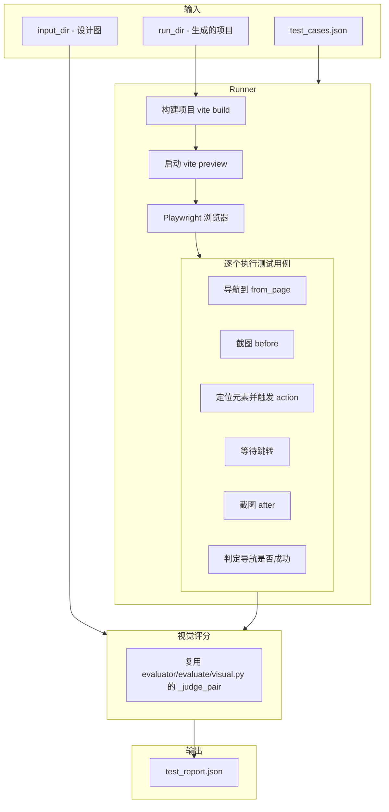

# TestGen Runner 实现方案

## 核心流程




## 关键实现细节

### 1. 路由映射问题

当前 `testgen/generator.py` 用 `page_name_to_route()` 猜路由（如 `bookshelf` -> `/bookshelf`），但实际路由可能不同（如 `book_friends_feed` 的实际路由是 `/friends` 而不是 `/book-friends-feed`）。

**解决方案**：runner 在执行前先从 `build_result.json` 或直接解析 `src/router.tsx` 拿到实际路由列表，然后做模糊匹配（page_name vs route path），覆盖掉 test_case 中的 `route_hint`。

复用已有的 `[evaluator/utils.py](evaluator/utils.py)` 中的 `parse_routes_from_router()` 函数。

### 2. 复用 evaluator 中的能力


| 能力                        | 来源                                                  | 复用方式                             |
| ------------------------- | --------------------------------------------------- | -------------------------------- |
| vite build + preview 服务管理 | `evaluator/evaluate/screenshot.py`                  | 提取端口、启动、关闭逻辑                     |
| Playwright 截图             | `evaluator/evaluate/screenshot.py`                  | 复用 viewport 配置（390x844, scale=2） |
| VLM 视觉评分                  | `evaluator/evaluate/visual.py` 的 `_judge_pair()`    | 直接调用                             |
| 路由解析                      | `evaluator/utils.py` 的 `parse_routes_from_router()` | 直接调用                             |


### 3. Action 执行策略

按 test_case 中的 `action.strategy` 分层尝试：

- **tab_click**: 先用 `dom_selector_hints` 中的选择器逐个尝试；失败则用 `text_hints` 文本匹配
- **text_match**: 用 Playwright 的 `page.get_by_text()` 或 `page.locator()` + `has_text` 过滤
- **vlm_coordinate**: 截图发给 VLM 获取点击坐标（兜底方案，此次暂不实现，标记为 skip）

### 4. 导航成功判定

- URL 变化：点击前后 `page.url` 不同
- DOM 变化：点击前后页面有实质性内容变化（`page.content()` hash 不同）
- 对于 overlay 类型（如 `bookshelf_import_dialog`）：URL 可能不变，改为检测新元素出现

### 5. 文件结构

```
testgen/
├── __init__.py         # (已有)
├── __main__.py         # (已有)
├── cli.py              # (已有) 增加 run 子命令
├── models.py           # (已有)
├── generator.py        # (已有)
├── runner.py           # [新增] 核心执行器
├── route_resolver.py   # [新增] 路由映射：page_name → 实际路由
└── actions.py          # [新增] Action 执行策略（元素定位 + 点击）
```

### 6. 使用方式

```bash
# 生成测试用例
python -m testgen input/wxreader-4/metadata.json -o output/test_cases.json

# 执行测试
python -m testgen run \
  --cases output/test_cases.json \
  --run-dir output/wxreader-4__agentic__claude-opus-4-6 \
  --input-dir input/wxreader-4 \
  --report output/test_report.json
```

### 7. 输出报告格式

写入 `run_dir/eval/test_report.json`，包含：

- 总通过率、按类型分层通过率
- 每个用例的详细结果（导航成功/失败、视觉分数、截图路径、错误信息）

